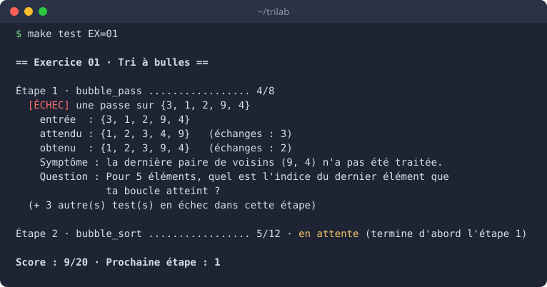

# TriLab

[](https://en.cppreference.com/w/c/11)
[](https://learn.microsoft.com/windows/wsl/)
[](#comment-on-est-corrigé)
[](#le-parcours)
[](#règles-du-jeu)

Apprendre les algorithmes de tri en C, par le code. Tu écris toi-même 16 tris, du tri à
bulles au Timsort. Le dépôt fournit les squelettes, les tests et les outils ; jamais la
solution.



Un test qui échoue montre ce qu'il observe et pose une question qui pointe vers la cause.
Il ne donne jamais la correction.

## Le parcours

| Phase | Exercices |
| --- | --- |
| Démarrage | 00 échauffement sur les pointeurs |
| Tris simples | 01 bulles · 02 sélection · 03 insertion |
| Améliorer les simples | 04 cocktail · 05 peigne · 06 Shell |
| Mesurer | 07 générateurs, chronomètre, compteurs, `make bench` |
| Diviser pour régner | 08 fusion · 09 rapide |
| Arbres | 10 ABR · 11 AVL · 12 tas |
| Sans comparaison | 13 comptage · 14 radix · 15 seaux |
| Générique | 16 tri façon `qsort` (`void *`, comparateurs, stabilité) |
| Hybrides | 17 introsort · 18 Timsort |
| Projet final | 19 bibliothèque `libtri`, outils `tri` et `tri-bench` |

Chaque notion de C arrive au moment où un algorithme en a besoin : `malloc` avec le tri
fusion, les `struct` récursives avec les arbres, `void *` avec le tri générique.

## Comment on est corrigé

| Couche | Ce qu'elle attrape | Commande |
| --- | --- | --- |
| Compilation stricte | types, conversions, variables inutilisées | `make`, `make check` |
| Tests par étapes | résultat faux, valeur perdue, boucle infinie, plantage | `make test` |
| ASan + UBSan | accès hors du tableau, fuite, débordement d'entier | `make check` |
| Valgrind | mémoire non initialisée, fuites | `make memcheck` (dès l'exercice 08) |
| Relecteur IA | logique, compréhension, un indice à la fois | `make review` |

## Installer (une fois)

Dans PowerShell, vérifie que la colonne VERSION affiche 2 : `wsl -l -v`. Puis dans Ubuntu :

```bash
sudo apt update
sudo apt install build-essential gdb valgrind
git clone https://github.com/H-sys7/trilab.git ~/trilab   # dans Linux, pas dans /mnt/c
cd ~/trilab
make doctor          # tout doit être vert
```

Éditeur : VS Code ou Cursor, connecté à WSL (`code ~/trilab`).

## Travailler un exercice

```bash
cd exercises/00_echauffement
make test            # lance les tests, détaille la première étape en échec
make check           # valide l'exercice : intégrité + ASan/UBSan + tous les tests
```

| Commande | Effet |
| --- | --- |
| `make` | compile (avertissements affichés) |
| `make test` | lance les tests ; `make test BONUS=1` ajoute les bonus |
| `make check` | critère de validation |
| `make memcheck` | tous les tests sous Valgrind (obligatoire dès l'exercice 08) |
| `make debug T=<test>` | ouvre gdb sur un test ; sans `T`, liste les tests |
| `make review` | prépare le paquet pour le relecteur IA |
| `make clean` | supprime `build/` |

Depuis la racine : mêmes commandes avec `EX=01`, plus `make status` (progression) et
`make doctor`.

Une fois l'exercice 07 validé : `make bench` mesure tous tes tris validés (environ 5 min ;
`make bench ALGO=insertion` pour un seul tri, `PROFIL=trie` pour un seul profil). Lis
ensuite `docs/complexite.md`, et note tes observations dans
`exercises/07_mesure/RESULTATS.md`.

Projet final (exercice 19, dossier `final/`) : la bibliothèque `libtri` et ses outils
`tri` et `tri-bench`. Tout est décrit dans `final/CONSIGNES.md` ; les commandes sont les
mêmes, dans `final/` ou depuis la racine avec `EX=19`.

Un exercice est **validé** quand `make check` passe (et `make memcheck` dès l'exercice 08).

## Règles du jeu

1. Tu ne modifies qu'un fichier par exercice : le `.c` de l'algorithme. Les autres sont
   protégés ; `make check` le vérifie.
2. Avance étape par étape : chaque `TODO(étape N)` correspond à une fonction, testée
   séparément. Les tests suivent cet ordre.
3. Lis d'abord le contrat dans le `.h` : il dit ce que la fonction doit produire, pas
   comment.
4. Un message d'échec décrit un symptôme et pose une question. Réponds-y avant de toucher
   au code.
5. Bloqué après `make check` ? `make review`, puis colle le paquet dans le projet Claude
   « TriLab — Relecteur » (instructions : `docs/RELECTEUR_IA.md`). Il donne un indice à
   la fois ; la solution seulement si tu écris SOLUTION.
6. Bibliothèque standard C11 uniquement.
